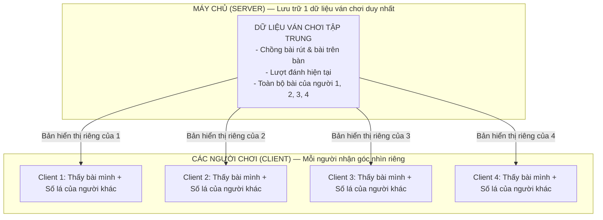
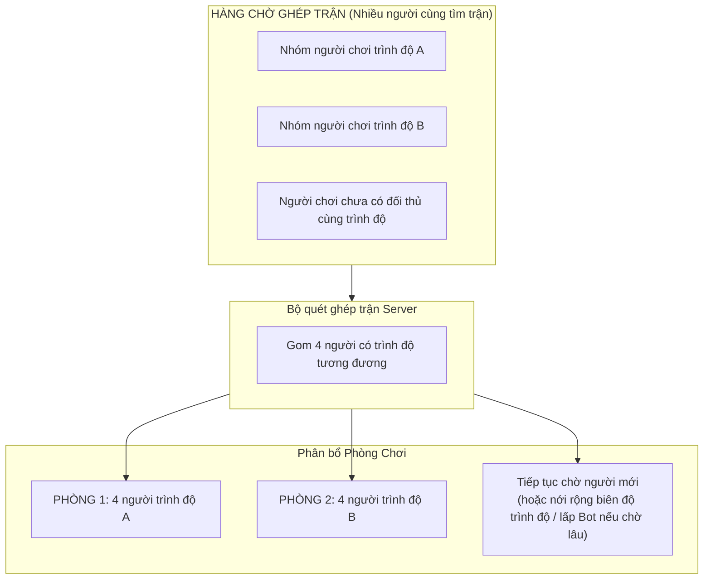
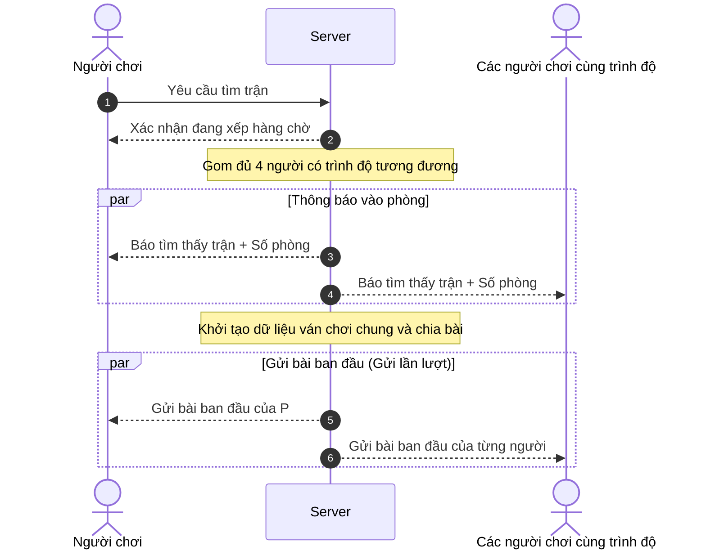
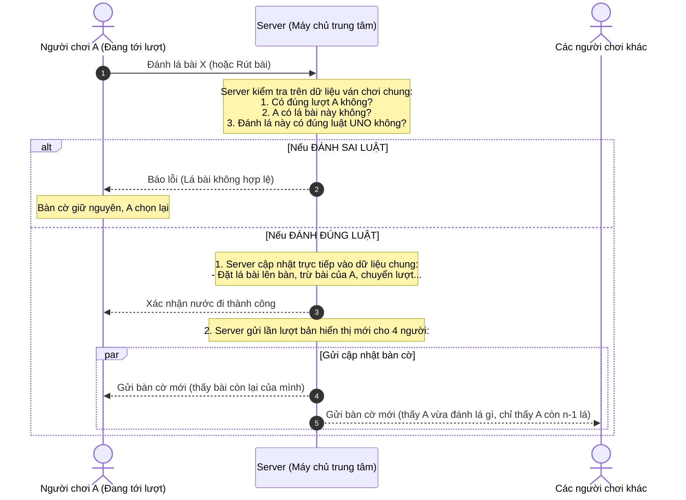
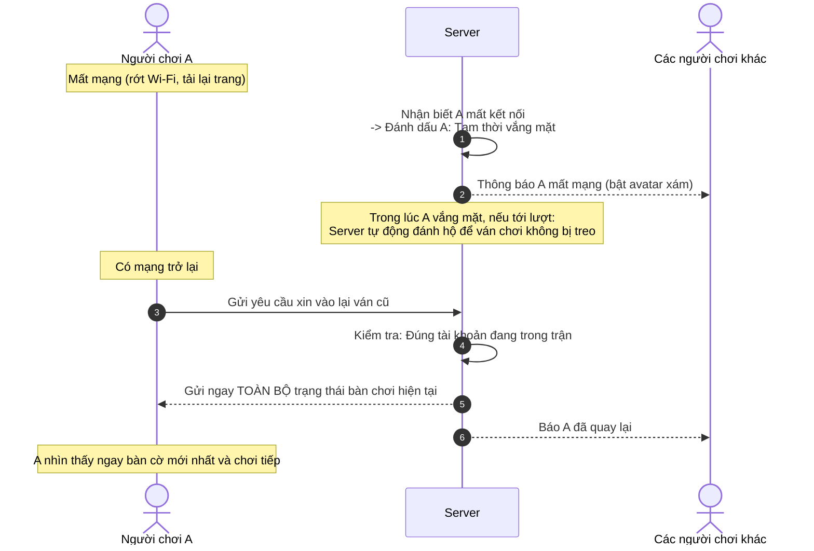
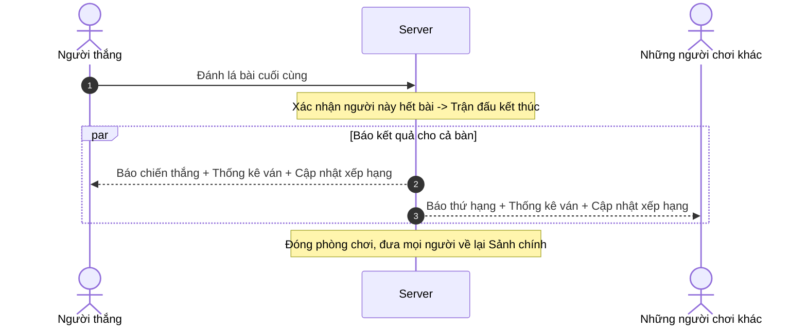

# UNO Multiplayer — Luồng Mạng Tổng Quan

> **Mục đích:** Tài liệu tóm tắt các luồng trao đổi mạng giữa Client và Server để đưa lên slide báo cáo và xin ý kiến giảng viên.  
> **Nguyên tắc:** Dễ hiểu, tập trung vào luồng đi của dữ liệu, không đi sâu vào chi tiết code/cài đặt.

---

## 1. Mô hình Mạng & Phân chia Dữ liệu Tổng quan

Hệ thống hoạt động theo mô hình **Client – Server tập trung** qua kết nối hai chiều liên tục (WebSocket):

* **Tại Server (Máy chủ trung tâm):** Lưu trữ **1 bộ dữ liệu ván chơi duy nhất** trong bộ nhớ (bao gồm: chồng bài rút, lá bài đang ở trên bàn, lượt đánh hiện tại, và bài trên tay của cả 4 người).
* **Tại mỗi Client (Người chơi):** Chỉ nhận được **dữ liệu hiển thị riêng cho mình** (bản nhìn tương ứng):
  * Thấy rõ chi tiết các lá bài của chính mình để chọn đánh.
  * Chỉ nhận **số lượng lá bài** của đối phương (giấu hoàn toàn thông tin lá bài của người khác để chống gian lận soi trộm bài qua mạng).

---

## 2. Các Luồng Mạng Chính Trong Ván Chơi

### Luồng 1: Hàng chờ & Ghép trận theo Trình độ (Matchmaking)

Khi có nhiều người chơi cùng lúc bấm tìm trận:
* Tất cả người chơi được đưa vào **Hàng chờ chung** trên Server kèm mức trình độ (điểm xếp hạng/ELO).
* **Nguyên tắc ghép phòng:**
  1. **Gom theo trình độ:** Server tự động tìm và gom các nhóm người chơi có trình độ tương đương nhau để tạo thành một ván đấu cân bằng.
  2. **Nới rộng biên độ theo thời gian chờ:** Với những người chưa tìm được đủ người cùng trình độ, Server sẽ mở rộng dần khoảng cách trình độ cho phép theo thời gian chờ để họ sớm tìm được trận.
  3. **Lấp Bot dự phòng:** Nếu thời gian chờ vượt quá giới hạn cho phép, Server tự động thêm Bot vào các vị trí còn trống để ván đấu được bắt đầu ngay, tránh để người chơi phải đợi quá lâu.

---

### Luồng 2: Lượt chơi & Đồng bộ bàn chơi (Trọng tâm)
Khi tới lượt, một người chơi thực hiện đánh bài hoặc rút bài:

---

### Luồng 3: Xử lý khi rớt mạng & Kết nối lại (Reconnect)
Giúp trận đấu không bị gián đoạn khi có người chơi gặp sự cố đường truyền:

---

### Luồng 4: Kết thúc ván chơi

---

## 3. Gợi ý 4 Slide Đơn giản để Báo cáo Thầy

| Slide | Nội dung chính cần trình bày | Hình ảnh / Sơ đồ minh họa |
|---|---|---|
| **Slide 1: Mô hình mạng & Dữ liệu** | - Mô hình Client – Server tập trung qua kết nối WebSocket. - Server giữ 1 bản dữ liệu ván chơi chung duy nhất. - Mỗi Client chỉ nhận góc nhìn riêng (giấu bài đối thủ để chống gian lận). | Sơ đồ mục 1 |
| **Slide 2: Hàng chờ & Ghép trận theo Trình độ** | - Người chơi vào hàng chờ trên Server kèm mức trình độ. - Gom các nhóm có trình độ tương đương để tạo phòng. - Nới rộng biên độ trình độ nếu chờ lâu; tự động lấp Bot nếu quá hạn. | Sơ đồ Luồng 1 |
| **Slide 3: Luồng đánh bài & Đồng bộ** *(Trọng tâm)* | - Client gửi nước đi $\rightarrow$ Server kiểm tra luật trên dữ liệu chung. - Sai: Báo lỗi $\rightarrow$ Đúng: Cập nhật dữ liệu và gửi lần lượt cho 4 người. | Sơ đồ Luồng 2 |
| **Slide 4: Xử lý rớt mạng & Kết thúc ván** | - Mất mạng: Server tạm thời đánh hộ để ván không bị dừng. - Vào lại: Server gửi lại ngay bàn cờ hiện tại. - Hết bài: Cập nhật xếp hạng và giải phóng bàn chơi. | Sơ đồ Luồng 3 & 4 |
